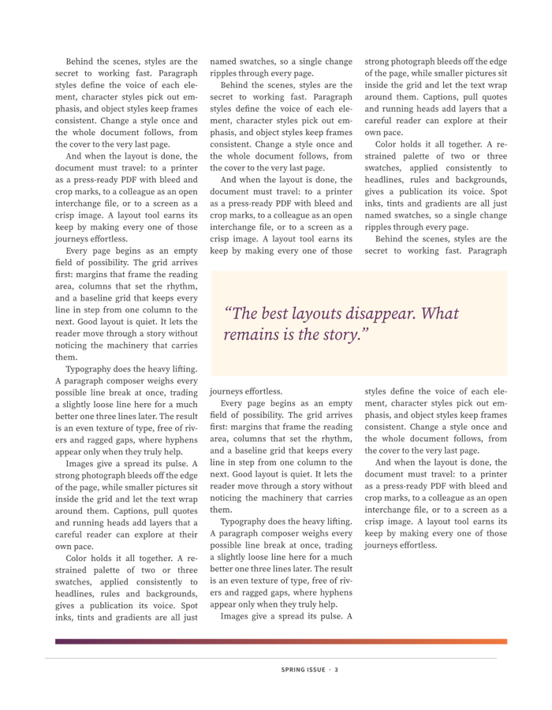
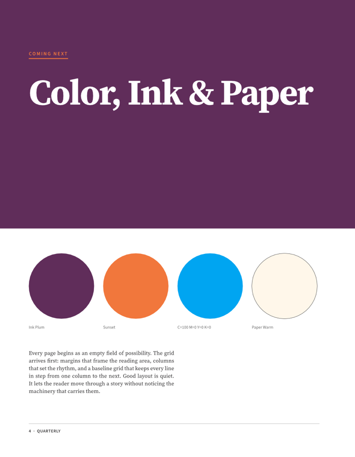

  <a href="../../releases">
    <picture>
      <source media="(prefers-color-scheme: dark)" srcset="docs/brand/artcraft-logo-white.svg">
      
    </picture>
  </a>

<h1 align="center">DesignCraft</h1>

  <b>Page layout and publishing; an open-source, clean-room reimplementation of Adobe InDesign, rebuilt in pure Rust.</b>

  A fast, open-source, clean-room take on the Adobe InDesign workflow. It runs natively on macOS,
  Windows and Linux, and in the browser via WebAssembly. 
  <i>By the ArtCraft team.</i>

  
  
  
  

 

  
   <b>Quarterly, Spring Issue</b>: threaded three-column body text, a wrapped pull quote and parent-page folios, all set by DesignCraft's own paragraph composer.

## The sample magazine

Every page below was laid out by DesignCraft from code (`crates/engine/src/sample.rs`) and exported
by its own renderer. Try it yourself with `File → New → Sample Document`, or start the app with
`--sample`.

<table>
<tr>
<td width="50%" valign="top">
<b>Cover.</b> A full-bleed graphic frame, display type and an italic deck.
</td>
<td width="50%" valign="top">
<b>Styles.</b> Kicker rule, headline, deck, caption and justified two-column body.
</td>
</tr>
<tr>
<td width="50%" valign="top">
<b>Threading, columns and text wrap.</b> One story flows through three columns and around the pull quote.
</td>
<td width="50%" valign="top">
<b>Swatches.</b> Named colors and a CMYK process swatch, laid out as a palette.
</td>
</tr>
</table>

## Why DesignCraft

- **Familiar.** InDesign's layout, tools, menus, panels and shortcuts: spreads and parent pages,
  frames and threaded stories, the Control panel, paragraph and character styles, swatches, text
  wrap and more. If you know InDesign, you already know how to use it.
- **Beautiful type.** A Knuth–Plass paragraph composer (plus single-line), dictionary hyphenation
  (the public-domain Moby word list plus our own trained patterns), word, letter and glyph-scaling
  justification, keeps, optical margin alignment, columns, baseline grid, tabs, rules and shading.
  Line breaks are identical on screen and in PDF.
- **Fast.** Multithreaded SIMD rendering (vello_cpu), copy-on-write documents with O(1) undo
  snapshots, and cached composition.
- **Open.** A documented native format, IDML import and export, and PNG, PDF (PDF/X-4, PDF/A-2b)
  and EPUB export.
  No subscription, no licence server, no telemetry.
- **Agent-native.** Every menu item, tool gesture, panel control and dialog can be driven over a
  JSON control channel and an **MCP server**, so Claude and other agents can lay out and edit
  documents like a designer.
- **Everywhere.** One Rust codebase for desktop and the web.

## Quick start

[View all releases](../../releases)

| Platform | Download | Run |
|----------|----------|-----|
| **Windows x64** | [designcraft-x64.7z](../../releases) | Run installer → launch `designcraft-x64.7z` |
| **Linux x64** | [designcraft-Linux-x64.run](../../releases) | `chmod +x` → run installer |
| **macOS Apple Silicon** | [designcraft-macOS-arm64.dmg](../../releases) | Open DMG → drag to Applications |

### Logs

The desktop app writes its `log` records to standard error and to `logs/designcraft.log` in the
settings directory, beside `ui.json` and `prefs.json` (Linux `~/.config/designcraft/logs/`, or
`$XDG_CONFIG_HOME/designcraft/logs/`; macOS `~/Library/Application Support/DesignCraft/logs/`;
Windows `%APPDATA%\DesignCraft\logs\`). A start launched from a desktop menu or the Dock has no
terminal, so this file is what to attach to a bug report: the crash guard's panic report and a
failed crash-recovery save land there. Each launch moves the previous log to `designcraft.1.log`
(and that one to `designcraft.2.log`), so the log of a run that crashed survives the next start.
The file stops growing at 16 MiB. `--version` writes no file.

| Variable | Effect |
|---|---|
| `RUST_LOG` | Log levels for standard error and the log file. Default: `info` for DesignCraft's own crates, `warn` for everything else. env_logger-style directives replace that, e.g. `RUST_LOG=debug`, `RUST_LOG=warn,designcraft_render=trace` or `RUST_LOG=info,wgpu_core=warn`; a directive ending in `*` covers every target starting with it (`designcraft*=debug`). |
| `WGPU_BACKEND` | The graphics backend that composites the window: `dx12`, `vulkan`, `gl` or `metal` (a comma-separated list lets wgpu choose among them). Default: DirectX 12 on Windows, Vulkan on Linux, Metal on macOS, with OpenGL as the fallback. Setting it also turns off the start-up fallback described below. |

The logger is `apps/designcraft/src/logging.rs`; the web build logs to the browser console instead.

### Graphics backend

The canvas is rendered on the CPU; the GPU only composites the interface, through wgpu. A
graphics driver that faults takes the process down before any Rust code can catch it, so the
backend is chosen before the window exists, and a start that never showed a frame is remembered:
`gpu.json` in the settings directory records the backend being tried until the first frame has
been presented. A record left behind means that backend crashed (or the app was killed) at
start-up, so the next start tries the next one (DirectX 12, Vulkan, then OpenGL on Windows;
Vulkan, then OpenGL on Linux) and says so in the status bar. The list starts over once every
backend has failed, or with a new DesignCraft version; delete the file or set `WGPU_BACKEND` to
start afresh. Seen in the wild: on an AMD hybrid-graphics laptop (a Radeon RX 6800M beside an
integrated Radeon) the AMD Vulkan driver faulted at the first present, which is why DirectX 12 is
the Windows default. The code is `apps/designcraft/src/gpu.rs`.

## Architecture

DesignCraft is an engine-first Cargo workspace with enforced layering (`cargo xtask layers`). The
egui frontend is a separate crate, so the UI can be swapped without touching the engine.

| Layer | Crates |
|---|---|
| L0 | `geom` (paths, units & measurement parsing, corner options) · `color` (CMYK/RGB/Lab, swatches, tints, gradients) |
| L1 | `doc` (spreads, pages, parents, layers, frames, stories, styles) · `fonts` (font DB, shaping, outlines) |
| L2 | `compose` (the text engine) |
| L3 | `render` (vello_cpu) |
| L4 | `tools` (pointer events → commands + overlays) |
| L5 | `engine` (session, history, command registry) |
| L6 | `ui-egui` (InDesign-style UI, control channel) |
| L7 | `apps/designcraft`, `apps/designcraft-cli`, `apps/designcraft-web` |

## License and credits

DesignCraft is dual-licensed under [MIT](LICENSE-MIT) or [Apache-2.0](LICENSE-APACHE), at your option.
Copyright (c) 2026 ArtCraft Team and the DesignCraft contributors. Required notices are in [NOTICE](NOTICE).
